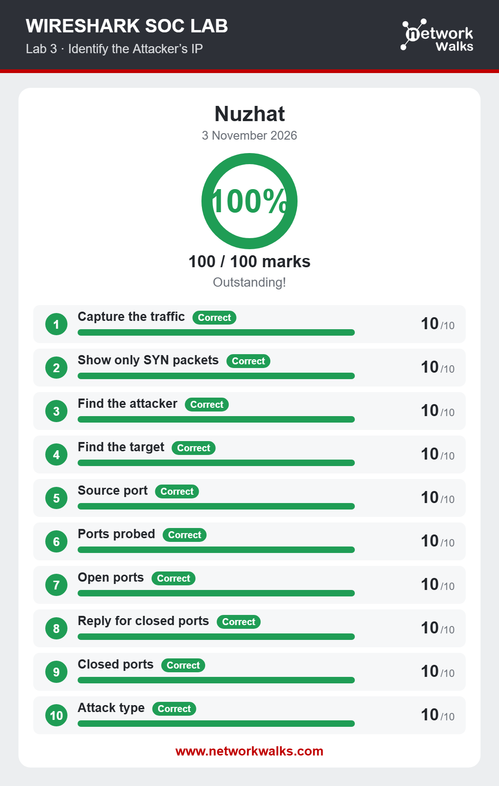
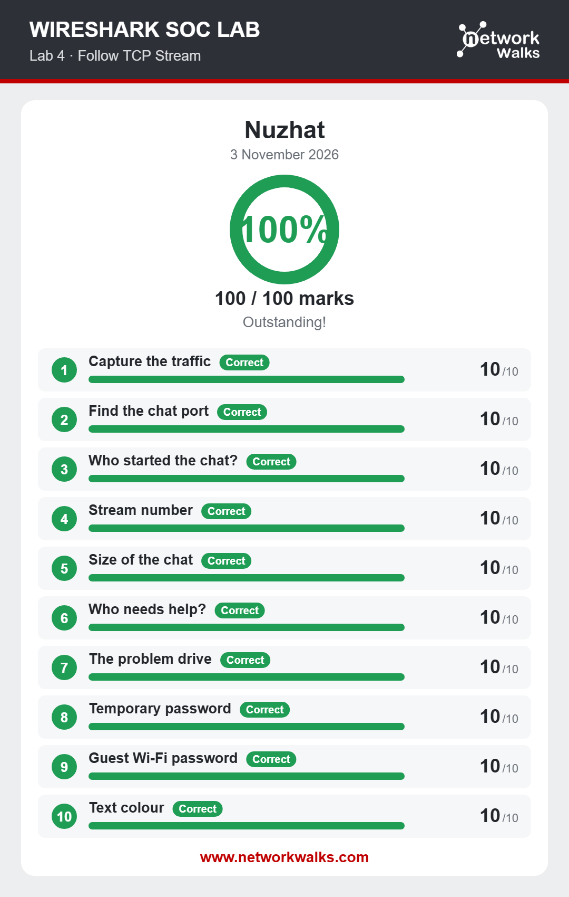
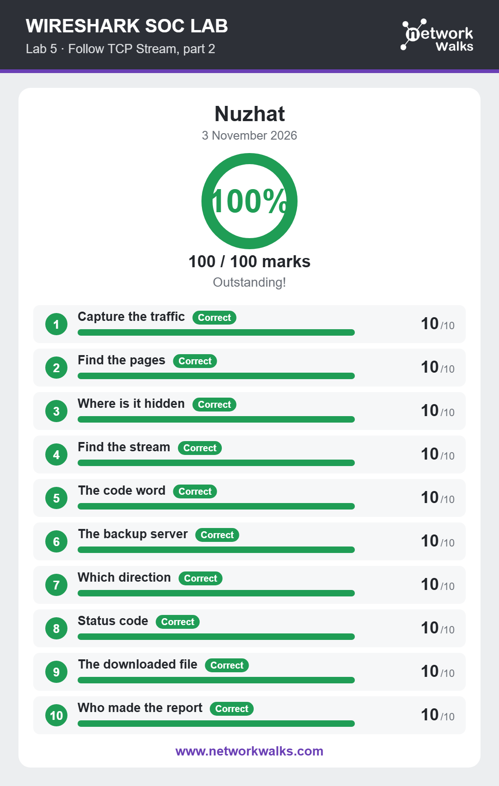
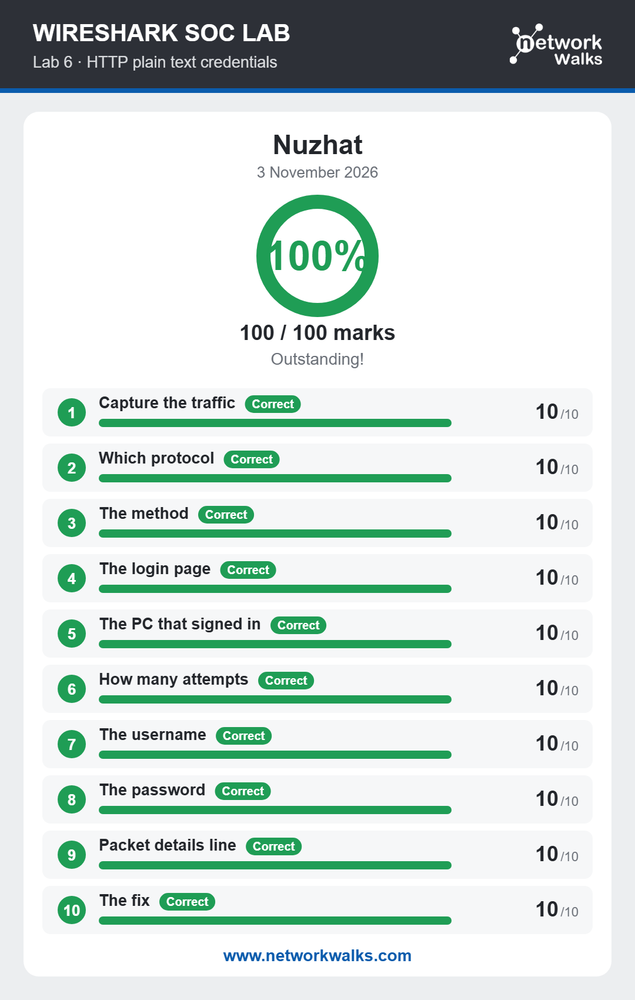
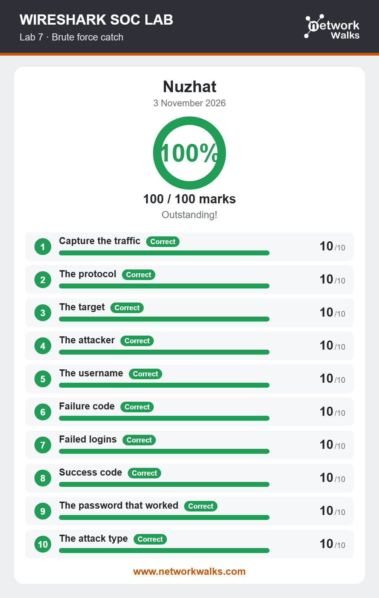
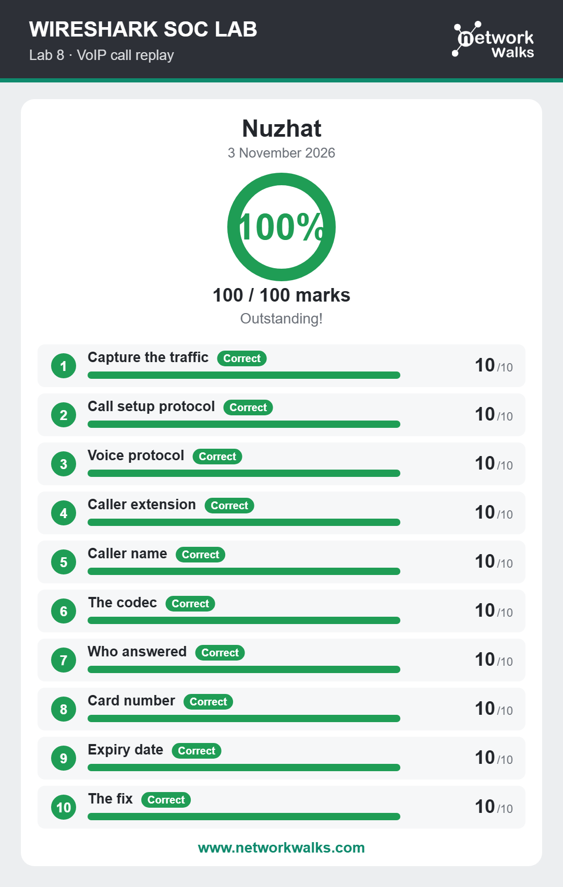

# 🔐 Cybersecurity Lab Environment Setup

**🛡️ Wireshark SOC Analyst – Network Traffic Analysis Labs**

  
  
  
   
  
    
  

---

## 📌 Project Overview
This project documents my hands-on experience with Wireshark through practical SOC (Security Operations Center) laboratory exercises.

The labs focus on network traffic analysis, TCP stream investigation, identifying suspicious network activity, detecting brute-force attempts, analyzing HTTP traffic, and investigating VoIP communications.

Through these exercises, I developed practical skills in examining network packets, identifying communication patterns, and understanding potential security threats.

---

## 🎯 Objectives

The main objectives of this project are to:
Understand network traffic and packet analysis.

Identify attacker and target IP addresses.

Analyze TCP connections and follow TCP streams.

Investigate HTTP communication and plaintext credentials.

Detect brute-force login attempts.

Analyze VoIP call setup and communication.

Identify suspicious network activities.

Develop practical SOC analyst investigation skills.

---

## 🛡️ Purpose of the Lab
The purpose of this lab is to gain hands-on experience with Wireshark and understand how network traffic can be monitored, captured, and analyzed for cybersecurity investigations.

Throughout these practical exercises, I focused on examining network packets, identifying suspicious connections, investigating communication between devices, and understanding common network-based attacks.

The main areas covered in this lab include:

Identifying attacker and target IP addresses.

Monitoring and analyzing TCP network traffic.

Investigating HTTP requests and exposed credentials.

Identifying suspicious login attempts and brute-force activities.

Analyzing VoIP communication and network protocols.

Understanding how packet analysis helps detect potential security threats.

---

## 🏗️ Lab Architecture

Lab 03 – Identify the Attacker's IP

Objective: Identify the attacker's IP address by analyzing captured network traffic.

Tasks:

Capture network traffic.

Filter SYN packets.

Identify the attacker.

Identify the target.

Investigate source ports.

Identify probed and open ports.

Analyze closed-port responses.

Determine the attack type.

Result: 100/100 Marks

---

Lab 04 – Follow TCP Stream

Objective: Investigate TCP communication and extract relevant information from captured network traffic.

Tasks:

Capture network traffic.

Identify the chat port.

Determine who initiated the conversation.

Identify the TCP stream number.

Analyze chat data.

Identify the person requiring help.

Investigate temporary and guest Wi-Fi passwords.

Result: 100/100 Marks

---

Lab 05 – Follow TCP Stream (Part 2)

Objective: Investigate TCP streams to identify hidden information and understand web communication.

Tasks:

Locate relevant web pages.

Identify hidden information.

Find the relevant TCP stream.

Identify a code word.

Investigate backup server communication.

Determine communication direction.

Analyze HTTP status codes.

Identify downloaded files and report information.

Result: 100/100 Marks

---

Lab 06 – HTTP Plaintext Credentials

Objective: Understand how unencrypted HTTP traffic can expose sensitive authentication information.

Tasks:

Identify the communication protocol.

Investigate the authentication method.

Locate the login page.

Identify the computer that signed in.

Analyze login attempts.

Identify usernames and passwords in the captured traffic.

Examine packet details.

Understand security improvements.

Result: 100/100 Marks

---

Lab 07 – Brute Force Detection

Objective: Investigate authentication traffic and identify potential brute-force attacks.

Tasks:

Identify the protocol.

Determine the target and attacker.

Identify the username.

Analyze failed login attempts.

Examine failure and success response codes.

Identify the password that worked in the lab capture.

Determine the attack type.

Result: 100/100 Marks

---

Lab 08 – VoIP Call Replay

Objective: Investigate VoIP network traffic and understand voice communication protocols.

Tasks:

Identify the call setup protocol.

Identify the voice protocol.

Find the caller extension and name.

Analyze the codec.

Determine who answered the call.

Investigate call-related information.

Understand the security implications of VoIP traffic.

Result: 100/100 Marks

---

# 🪜 Lab Setup Procedure

## Step 1. Install Wire-Shark

**Tool:** https://2.na.dl.wireshark.org/win64/Wireshark-4.6.9-x64.exe?_gl=1*1r0e1nw*_gcl_au*ODgwMjI1NzUwLjE3OTM1NTQzMzE.*_ga*MTA3NjM5MTg0Ni4xNzkzNTU0MzE4*_ga_YLHRKD6LH6*czE3OTM3ODc3ODgkbzIkZzEkdDE3OTM3ODc3OTAkajU4JGwwJGgw

---

🛠️ Tools & Technologies

Tool                          Purpose

Wireshark           ||   Network packet analysis

TCP/IP               ||   Network communication analysis

HTTP                 ||   Web traffic investigation

VoIP                 ||  Voice communication analysis

Network Filters      ||  Traffic filtering

PCAP Analysis        ||  Network forensics

---
🧠 Skills Developed

Network Traffic Analysis

Packet Inspection

TCP Stream Analysis

IP Address Identification

Port Scanning Detection

HTTP Traffic Investigation

Brute Force Detection

Authentication Analysis

VoIP Traffic Investigation

SOC Monitoring Fundamentals

Network Forensics

---

# 💡 What I Learned

Through these hands-on Wireshark SOC labs, I gained practical knowledge of network traffic analysis, packet inspection, and cybersecurity investigation.

The key concepts and skills I learned include:

1. Network Traffic Analysis

Learned how to capture and analyze network packets using Wireshark.

Understood how devices communicate over a network.

Learned to apply display filters to identify specific traffic.

2. Attacker IP Identification

Learned how to identify attacker and target IP addresses.

Analyzed TCP SYN packets to understand connection attempts.

Identified source ports, destination ports, open ports, and closed ports.

Gained an understanding of network reconnaissance and port scanning.

3. TCP Stream Analysis

Learned how to follow TCP streams to reconstruct network conversations.

Identified communication between different hosts.

Extracted relevant information from captured TCP traffic.

Understood how TCP stream analysis helps in network investigations.

4. HTTP Traffic & Credential Analysis

Learned how HTTP requests and responses work.

Identified login requests and authentication information in unencrypted traffic.

Understood the security risks of transmitting sensitive information over plaintext HTTP.

Learned why HTTPS is important for protecting user credentials.

5. Brute Force Attack Detection

Learned how to investigate repeated login attempts.

Identified failed and successful authentication responses.

Analyzed suspicious login patterns.

Understood how SOC analysts can detect potential brute-force attacks.

6. VoIP Traffic Analysis

Learned about SIP and RTP protocols.

Analyzed VoIP call setup and communication.

Identified caller information, call responses, and audio codecs.

Understood potential security risks associated with unprotected VoIP traffic.

7. SOC Analyst Investigation Skills

Improved my ability to investigate suspicious network activity.

Developed practical packet analysis and network forensics skills.

Learned how to identify potential indicators of compromise (IOCs).

Improved my understanding of network security monitoring and threat detection.

💡 Key Takeaway

These practical exercises strengthened my understanding of how Wireshark is used in real-world cybersecurity investigations. I gained hands-on experience in identifying suspicious network traffic, analyzing communication protocols, and understanding common attack techniques from a SOC Analyst perspective.

---
🔐 Security & Ethical Use

This project is intended for educational and authorized cybersecurity training purposes only.

All packet analysis and investigation activities should be performed on authorized lab traffic. Sensitive credentials, personal information, and private packet captures should never be published publicly.

# 👤 Author

**Nuzhat Shaheen**\
Cybersecurity intern (Batch: B084)

LinkedIn: [https://www.linkedin.com/in/nuzhat-akbar-a17963289)

---

## 📌 Project Information
Program Name: Cybersecurity internship  at Networkwalks
|Week:01| Extra WireShark Project1: Wireshark – SOC Analyst Practical Labs
Domain | Cybersecurity / Network Security

